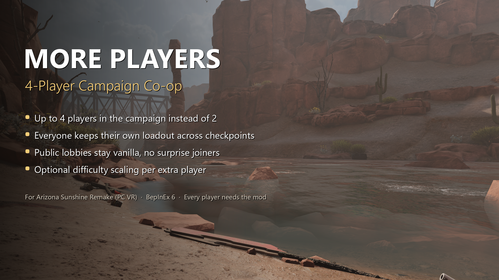

# More Players for Arizona Sunshine Remake



Play the Arizona Sunshine Remake co-op campaign with up to **4 players** instead of 2. A BepInEx 6 plugin; nothing
in the game files is modified.

**Download:** [Nexus Mods](https://www.nexusmods.com/arizonasunshineremake/mods/4)

## Features

- Campaign lobbies you host get up to 4 slots (configurable 2-4). Horde is unchanged.
- Joiners take the lobby size from the host automatically, nothing to coordinate.
- **Everyone keeps their own loadout.** The game's checkpoint save only had room for 2 players; without the fix players
  2-4 would swap loadouts at every checkpoint and level change. Loadouts are tied to each player's account, so they
  stay with the right person no matter in which order people join or load into a level.
- Public lobbies stay at 2 players unless the host opts in, so strangers without the mod can't break your game.
- With the mod installed you can still join normal 2-player games and play Horde as usual.
- Optional difficulty scaling (off by default): more zombies and more ammo per extra player.

Every player in the session needs the mod.

## Installation

1. Install [BepInEx 6 for IL2CPP](https://builds.bepinex.dev/projects/bepinex_be) (build 6.0.0-be.788, win-x64) into
   the game folder, or use the preconfigured BepInEx file from the Nexus page.
2. Copy `AZS1HD.MorePlayers.dll` to `BepInEx\plugins\AZS1HD.MorePlayers\`.
3. Start the game. The first launch with BepInEx takes 1-3 minutes on a black screen.
4. Host a campaign lobby, set it to Private or Friends only, and invite up to 3 friends.

## Settings

`BepInEx\config\azs1hd.moreplayers.cfg`, created on the first launch:

```ini
[General]
CampaignLobbySize = 4            # 2-4, size of campaign lobbies YOU host
AllowPublicLobbies = false       # also enlarge public lobbies
AllowFriendsOnlyLobbies = true
PatchSteamLobbyLimit = true
[Scaling]                        # only the host's settings matter
Enabled = false
ZombieCountMultiplierPerPlayer = 1.25
AmmoMultiplierPerPlayer = 1.5
BaselinePlayers = 1
MaxZombieFactor = 3
ScaleAliveZombieCaps = true
ScaleHorde = false
[Debug]
VerboseLogging = false
```

## How it works

The remake runs on the Arizona Sunshine 2 engine code (Unity 2022.3, IL2CPP). The plugin uses Harmony patches:

| Game code | What the mod does |
|---|---|
| `MatchmakingSystem.TryStartMatchmaking` is called with 2 players per team when a campaign lobby is hosted | Hosted private / friends-only campaign lobbies get `CampaignLobbySize` slots (party size and Photon room size) |
| `LevelSettingsTO.maxPlayers` sets server slots, max connections, the "room full" check and the network entity id ranges on every machine | Follows the size of the party you are in (original value restored afterwards) |
| `SteamMatchmaking.CreateLobby` member limit | Raised |
| The hands / inventory / health / resources savables write the host to save entry 0 and every other player to entry 1 | Each save entry belongs to one player account (host = entry 0); the save's player array grows as needed. The table is kept per save slot in `BepInEx\config\azs1hd.moreplayers.saveentries.json` on the host |
| The host sends the save to every joiner with "load entry 1" | Each joiner gets its own copy with its own entry index |
| Spawn events, alive caps and dynamic ammo ignore the player count | Optional per-player scaling on the host |

Source files: `Plugin.cs` (lobby and level size), `SaveSlots.cs`, `SaveEntryTable.cs` and `SaveJson.cs` (per-player
saves), `Scaling.cs` (difficulty).

Only the host's save matters: if you continue a save with a different host, the joiners get entries as they come.

## Building

Requirements: .NET SDK 8 or newer, and the game with BepInEx 6 IL2CPP installed and launched once (so that
`BepInEx\interop` exists; the project references those generated assemblies, which are not part of this repository).

```sh
cd src/MorePlayers
dotnet build -c Release -p:GameDir="C:\Program Files (x86)\Steam\steamapps\common\Arizona Sunshine Remake"
```

`GameDir` can also come from the `AZS_GAME_DIR` environment variable; without either, the default Steam location is
used. The plugin ends up in `bin/Release/net6.0/AZS1HD.MorePlayers.dll`.

The save JSON helpers have game-independent tests: `cd tests/SaveJsonTests && dotnet run`.

## License

Copyright (C) 2026 Mikael Järvinen.

Licensed under the [GNU General Public License v3.0](LICENSE) with the [additional terms](ADDITIONAL-TERMS.md):
you may modify and redistribute this mod, and versions you distribute must be released under the same license with
their source code, and must keep the credit to the original author. The additional terms also allow the mod to be
used with the game and its proprietary libraries.

## Credits

The lobby-derived level size and private-lobby default were inspired by "AS2 More Players" by NikoNovice for
Arizona Sunshine 2. Built with [BepInEx](https://github.com/BepInEx/BepInEx),
[Il2CppInterop](https://github.com/BepInEx/Il2CppInterop) and [HarmonyX](https://github.com/BepInEx/HarmonyX).

Unofficial fan mod, not affiliated with or endorsed by Vertigo Games.
